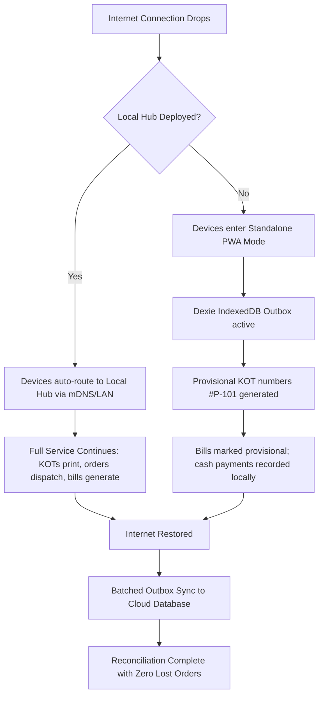

# RestaurantOS Launch Kit & Operational Runbook

## 1. Owner Setup Checklist (Pre-Go-Live)

Complete these 8 configuration steps in the **Owner Console** before opening service to the public:

- [ ] **1. Business Day & Timezone Configuration**
      _Path:_ `Owner Console > Settings > Business Day`
  - Set `day_start_time` (Default: `05:00` AM). This ensures dinner services past midnight reconcile to the correct date.
  - Confirm timezone: `Asia/Kolkata` (IST).

- [ ] **2. Floor Layout & Table Map**
      _Path:_ `Owner Console > Settings > Floor & Tables`
  - Create dining sections (e.g., _Main Dining_, _AC Family Hall_, _Rooftop/Patio_).
  - Assign table numbers and default guest capacity per table.

- [ ] **3. Menu Catalog & Tax Rules**
      _Path:_ `Owner Console > Menu Management`
  - Upload or verify item catalog, categories, pricing, and Veg/Non-Veg flags.
  - Set standard Restaurant GST rate: **5% GST** (2.5% CGST + 2.5% SGST) or **18% GST** (if AC luxury/liquor applicable).
  - Confirm whether menu prices are tax-inclusive or tax-exclusive (Default: _Tax exclusive_).

- [ ] **4. UPI Dynamic QR Payment Setup**
      _Path:_ `Owner Console > Settings > Payments`
  - Enter Merchant VPA (Virtual Payment Address, e.g. `restaurantname@hdfcbank` or `restaurantname@icici`).
  - Enter Registered Merchant Name (must match banking records for instant reconciliation).
  - Test print a ₹1 verification QR code to ensure phone UPI apps parse amount and order ref correctly.

- [ ] **5. Thermal Printer Hardware Pairing**
      _Path:_ `Owner Console > Settings > Hardware & Printers`
  - Configure Billing Counter Printer (80mm Ethernet/USB).
  - Configure Kitchen Station Printer (80mm/58mm Network IP port `9100`).
  - Send test prints to confirm font sizes, column alignments, and cutter firing.

- [ ] **6. Opening Cash Float**
      _Path:_ `Owner Console > End of Day > Day Start`
  - Record opening cash drawer balance (e.g. ₹2,000 in small change notes and coins).

- [ ] **7. Staff Accounts & Passcodes**
      _Path:_ `Owner Console > Settings > Staff & RBAC`
  - Provision unique PINs for Captains, Waiters, Kitchen Chefs, and Cashiers.
  - Store the emergency Master Owner PIN in a secure location.

- [ ] **8. Local Hub Pairing (Optional but Recommended)**
      _Path:_ `Owner Console > Settings > Local Hub`
  - Verify Local Hub container is running on the counter computer (`http://localhost:3000`).
  - Ensure all waiter tablet/phone devices are connected to the restaurant local Wi-Fi SSID.

---

## 2. Staff Quick-Start Reference Cards

### 📱 Waiter Quick-Start Card

1. **Login:** Enter your 4-digit staff PIN on your handheld or tablet.
2. **Select Table:** Tap green table card. If occupied (amber/blue), tap to open active order.
3. **Filter Menu:** Use the **VEG ONLY** switch at the top when serving vegetarian guests.
4. **Add Items & Customizations:** Tap item to add. Tap **Modifiers** to add notes (e.g., _Less Spicy_, _No Onion_, _Extra Gravy_).
5. **Send to Kitchen (KOT):** Tap **Fire KOT**. The kitchen screen immediately dings and the kitchen printer cuts ticket.
6. **Repeat Orders:** Tap the table anytime to append new items under KOT-2 without disrupting the initial items.
7. **Settling the Bill:** When guests ask for the check, tap **Request Bill**. Show the customer the dynamic on-screen UPI QR or tender cash.

---

### 🍳 Kitchen Display (KDS) Quick-Start Card

1. **New Orders:** Orders appear in the **RECEIVED** column (highlighted in Blue) with real-time timer counters.
2. **Start Preparation:** Tap **Start Cooking** to move the ticket to **PREPARING** (Amber).
3. **Item Bumping:** For multi-dish orders, tap individual items as they finish so servers know partial items are ready.
4. **Order Ready:** Tap **Mark Ready** when all dishes are plated. The ticket moves to **READY** (Green) and notifies the waiter.
5. **Rush Mode:** During dinner rush, toggle **Rush Mode (⚡)** on the top right to condense cards and prioritize oldest tickets.
6. **Mark Item Out of Stock (86 List):** Tap **86 Item** to prevent waiters from taking orders for finished ingredients.

---

### 💵 Cashier & Counter Quick-Start Card

1. **Generate Bill:** Review table order summary, apply valid customer loyalty reward points if provided, and click **Print Bill**.
2. **Payment Processing:**
   - **UPI:** Customer scans dynamic QR code on the receipt or customer-facing display.
   - **Cash:** Enter cash tendered; the system calculates exact change.
   - **Split Payment:** Tap **Split Bill** to accept part Cash and part UPI/Card.
3. **Discounts & Comps:** Manager/Owner PIN override required for discounts exceeding standard 10% tolerance.
4. **End-of-Shift Reconciliation:** At close, click **Reconcile Drawer**, count physical currency denominations, enter counts, and submit for end-of-day audit.

---

## 3. Outage & Emergency Failover Runbook

### Steps During Standalone Outage (No Hub):

1. The app displays an amber banner: `Working Offline (Standalone Cache)`.
2. Do not clear browser cache or refresh the page forcibly. Continue taking orders and collecting payments normally.
3. Once Wi-Fi/Internet returns, the sync banner will show `Syncing 14 pending events...` followed by a green `Synced` indicator.
4. If an alert shows `Conflict Review Required`, the Owner opens `Owner Console > Sync Problems` to accept or review conflicting mutations.

---

## 4. Privacy, Customer Data & Tax Statutory Notes

- **Customer Phone Privacy:** Waiters see only masked customer telephone numbers (`+91 98XXX XX123`). Full numbers are encrypted at rest and accessible only to the restaurant owner for regulatory audit.
- **Loyalty Program Consent:** When enrolling a new customer via phone number, verify verbally that the customer agrees to receive loyalty rewards.
- **GST Invoice Mandate:** Printed receipts display the Restaurant Legal Entity Name, GSTIN, FSSAI License Number, itemized tax rates (CGST & SGST), and invoice timestamp in compliance with statutory food & beverage tax regulations.
